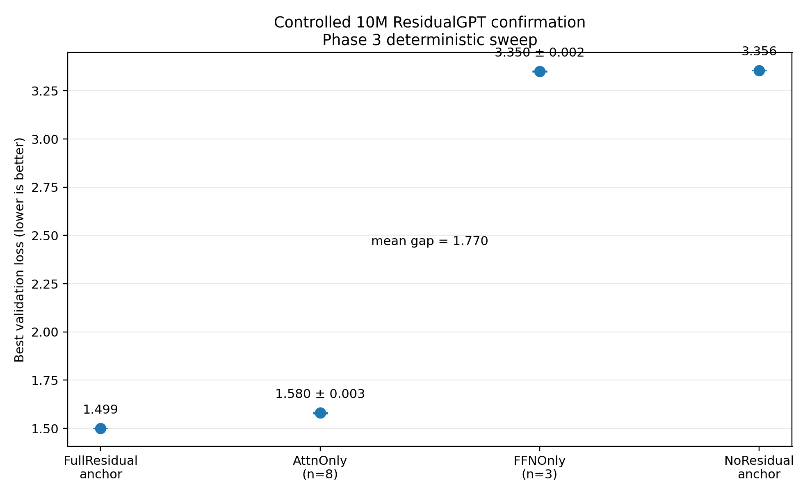
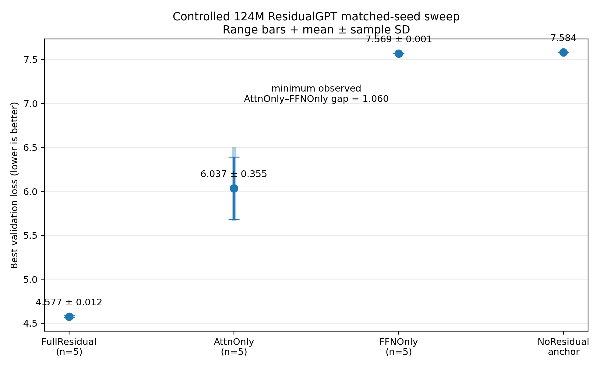
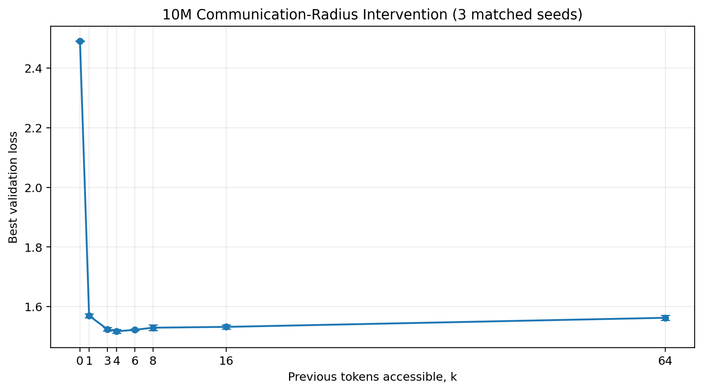

# Partial Residual Ablations in Pre-LN Transformers

**Controlled experiments at 10M and 124M parameters, with a 10M intervention study of cross-token communication.**

**Pratik Kumar Babariya** · Independent research

[Paper on arXiv](https://arxiv.org/abs/2608.14689) · [Results](#controlled-results) · [Communication study](#how-much-communication-is-needed) · [Code and reproducibility](#code-and-reproducibility) · [Limitations](#limitations)

> **Main finding:** In the tested Pre-LN GPT-style models, retaining the attention skip while removing the FFN skip trains to substantially lower loss than the opposite ablation. Both remain worse than the full-residual baseline. In a separate 10M study, allowing one preceding token **per attention layer** produces a large improvement over self-only attention.

This repository accompanies *A Reproducibility Study of Partial Residual Ablations in Pre-LN Transformers*. This README summarizes the revised manuscript, including its newer controlled sweeps and communication experiments. The public code release is partial; see the availability notes below before attempting to reproduce a table. The linked arXiv version may precede the latest manuscript revision.

## Research question

What changes when a transformer loses one of its two residual skip connections? Does the answer depend on the implementation, and how does cross-token communication affect the resulting model?

The main ablations retain both attention and FFN sublayers. **“AttnOnly” and “FFNOnly” name the surviving skip connection, not the surviving sublayer.**

| Configuration | Attention skip | FFN skip |
|---|:---:|:---:|
| FullResidual | Kept | Kept |
| AttnOnly | Kept | Removed |
| FFNOnly | Removed | Kept |
| NoResidual | Removed | Removed |

The study combines residual-path ablations, multi-seed comparisons, gradient and activation diagnostics, and interventions that restrict communication between token positions. Failed reproductions and implementation changes are retained as part of the experimental record.

## Controlled results

**Metric:** best validation cross-entropy loss; lower is better. Multi-seed entries report mean ± **sample standard deviation**, not confidence intervals. Single-run anchors have no estimated seed uncertainty. These are manuscript-reported summaries; this README does not claim a fresh recomputation from every underlying run.

### 10M · TinyShakespeare



*Controlled Phase-3 sweep (paper Figure 5). Points show aggregate best-validation-loss statistics; error bars show sample SD where available. FullResidual and NoResidual are single-run anchors. Individual seed values are not reconstructed from aggregate statistics.*

| Configuration | Best validation loss | Runs |
|---|---:|---:|
| FullResidual | 1.499 | 1, anchor |
| AttnOnly | **1.580 ± 0.003** | **8** |
| FFNOnly | 3.350 ± 0.002 | 3 |
| NoResidual | 3.356 | 1, anchor |

The AttnOnly–FFNOnly mean separation is **1.770 loss units**. The eight-seed count applies to AttnOnly, not every configuration.

### 124M · OpenWebText



*Controlled matched-seed sweep (paper Figure 7). Error bars show sample SD; lighter bars show observed min–max ranges. FullResidual, AttnOnly, and FFNOnly use the same five seeds. NoResidual is a single-run anchor.*

| Configuration | Best validation loss | Runs | Observed range |
|---|---:|---:|---:|
| FullResidual | **4.577 ± 0.012** | 5 | 4.560–4.592 |
| AttnOnly | 6.037 ± 0.355 | 5 | 5.662–6.508 |
| FFNOnly | 7.569 ± 0.001 | 5 | 7.568–7.570 |
| NoResidual | 7.584 | 1, anchor | — |

Matched seeds: `1337, 42, 123, 0, 7`. Every observed AttnOnly run has lower loss than every observed FFNOnly run; the closest observed pair is separated by **1.060 loss units**. AttnOnly nevertheless remains substantially worse than FullResidual and has greater observed seed variation.

The NoResidual anchor stopped at step 18,000; its best logged loss occurred at step 2,000. It is not a five-seed, full-budget comparison.

**Compare configurations within each sweep.** Different datasets, tokenizers, and documented environments make absolute 10M and 124M losses unsuitable for a direct scale comparison. Historical and controlled runs are not pooled.

## How much communication is needed?

The separate mechanism study holds the **AttnOnly residual topology** fixed and changes communication between token positions. A parameter-matched, position-wise LocalMixer supplies an additional no-communication control.

For windowed attention, query position `t` may attend to `max(0, t − k) … t`:

- `k = 0`: current token only.
- `k = 1`: current token plus one preceding token **within each layer**.
- Larger `k`: wider local causal attention.

**The radius is per layer.** Across six stacked layers, information can travel farther than one token even when `k = 1`. The visibility sanity check tests one attention module, not the receptive field of the full network.



*Replicated 10M intervention (paper Figure 8). Points show means across seeds 1337, 42, and 123; error bars show sample SD. The right panel enlarges the nonzero-radius results. Radii occupy equally spaced categorical positions; connecting lines guide the eye.*

| Intervention | Best validation loss | Runs |
|---|---:|---:|
| Position-wise LocalMixer | 2.490527 ± 0.000369 | 3 |
| Self-only attention, `k = 0` | 2.490865 ± 0.000849 | 3 |
| One preceding token per layer, `k = 1` | **1.569693 ± 0.006865** | 3 |
| Lowest tested replicated mean, `k = 4` | **1.517060 ± 0.006029** | 3 |

Moving from `k = 0` to `k = 1` improves mean loss by **0.921172**. Replicated radii `3, 4, 6, 8, 16, 64` remain in the lower-loss regime, with non-monotonic changes as the window grows.

**Interpretation:** in this 10M setting, removing cross-position communication degrades performance, while a small local window recovers much of it. Global attention is unnecessary for this observed transition. The study does not establish that this benefit is unique to residual removal; matched radius sweeps under FullResidual and other residual configurations remain an important control.

## Experimental setup

| Setting | 10M experiments | 124M experiments |
|---|---|---|
| Architecture | 6-layer Pre-LN GPT-style transformer | 12-layer Pre-LN GPT-style transformer |
| Embedding width / heads | 384 / 6 | 768 / 12 |
| Dataset / tokenization | TinyShakespeare / characters | OpenWebText / BPE |
| Context length | 256 | 1,024 |
| Training budget | 3,000 steps | 20,000 steps, except interrupted anchor |
| Evaluation | Fixed validation batches | Fixed validation batches |

ResidualGPT uses tied embedding/output weights and PyTorch scaled dot-product attention. Validation batches are fixed using seed `99991`. See the manuscript for optimizer, initialization, learning-rate schedules, and environment details.

## Code and reproducibility

### Available entry points

| Material | Location | Scope |
|---|---|---|
| 10M training and reproduction notebooks | [Notebooks/10M](Notebooks/10M/) | Earlier ResidualGPT, nanoGPT, seed-stability, and mixer investigations |
| 124M notebooks | [Notebooks/124M](Notebooks/124M/) | Earlier training and additional-seed investigations |
| Stored CSV results | [Results](Results/) | Historical result tables; not a complete archive of the revised sweeps |
| Diagnostic package | [residualscope](residualscope/) | Gradient/activation diagnostics, comparison utilities, example, and tests |
| Featured revised figures | [Figures](Figures/) | Controlled summaries and communication-radius results shown above |

**Release status:** the revised manuscript reports experiments beyond the earlier notebook and CSV release. The new mechanism notebooks, complete individual-run histories for the controlled sweeps, and checkpoints are not all available in this repository. The figures summarize reported results; they do not substitute for raw logs. Full independent reproduction of the revised manuscript remains dependent on completing that release.

### Explore the existing code

```bash
git clone https://github.com/pratik376/Why-Partial-Residuals-fails.git
cd Why-Partial-Residuals-fails
```

For training, start with the relevant notebook's setup cells and inspect its dataset, output-path, and hardware assumptions before execution. The historical notebooks are not a one-command reproduction of the newer controlled tables.

For the bundled diagnostic package and its unit tests:

```bash
python -m pip install -e "./residualscope[dev]"
python -m pytest residualscope/tests -v
```

These tests exercise the diagnostic utilities; passing them does not reproduce the paper's training results. The package's toy example is likewise separate from the 10M/124M experiments.

For meaningful reproduction, preserve the code revision, dependency versions, GPU/CUDA environment, dataset split, seeds, initialization, evaluation batches, and training budget alongside each run. Deterministic settings do not establish equivalence across different hardware and software environments.

## Experimental history

<details>
<summary>Why the newer conclusions differ from the original README</summary>

1. **Initial nanoGPT experiments:** both partial-residual configurations reached a high-loss regime near NoResidual.
2. **Historical ResidualGPT experiments:** the originally recorded 10M AttnOnly result was approximately `1.600 ± 0.015`.
3. **Intermediate reproduction:** the historical report was `2.591 ± 0.544`, including a run near the high-loss floor. This statistic is retained as reported, rather than presented as newly revalidated; its SD convention should not be equated with the newer sample SDs.
4. **Controlled follow-up:** the later 10M and 124M sweeps establish the within-sweep asymmetry summarized above. The cause of the earlier cross-environment discrepancy remains unresolved.
5. **Communication interventions:** the revised work adds matched-seed LocalMixer and windowed-attention studies in the clean 10M environment.

The implementation transition changed validation batching, weight tying, attention implementation, and optimizer/initialization details together. **Fixed validation batches alone were not established as the cause of recovery.**

A runtime output-gain experiment was also replaced with weight-level initialization. Runtime scaling changes the forward computation throughout training and does not isolate an initialization-only intervention; the earlier interpretation is retained as a methodological caution.

</details>

## Limitations

- Results describe finite training budgets and the tested Pre-LN GPT-style architectures, not all transformers or asymptotic convergence.
- The communication study is limited to 10M TinyShakespeare models; its mechanism has not been established at 124M.
- Single-run anchors do not establish seed variability or statistical equivalence to a multi-seed configuration.
- Small seed counts and descriptive SDs do not establish distribution tails or formal statistical significance.
- The lowest tested mean at `k = 4` does not establish a universally optimal attention window.
- The implementation changes were bundled, and the earlier reproduction discrepancy remains unresolved.
- Public release completeness and independent reproduction remain separate from manuscript consistency.

## Citation

```bibtex
@misc{babariya2026partialresiduals,
  title         = {A Reproducibility Study of Partial Residual Ablations in Pre-LN Transformers},
  author        = {Babariya, Pratik Kumar},
  year          = {2026},
  eprint        = {2608.14689},
  archivePrefix = {arXiv},
  primaryClass  = {cs.LG},
  url           = {https://arxiv.org/abs/2608.14689}
}
```

For a reproduction report, please [open an issue](https://github.com/pratik376/Why-Partial-Residuals-fails/issues) with the code revision, environment, configuration, seed, and relevant logs. Reports that challenge or narrow the conclusions are welcome.
